## 1 Склонировали репозиторий с гибхаба и сделали все приготовления для выполнения лабораторной работы, сделали первый коммит
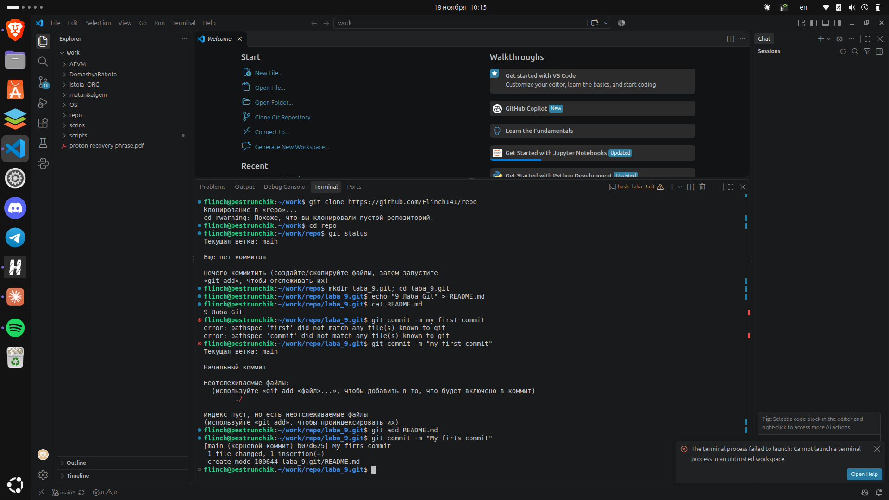
## 2 Запушили первый коммит
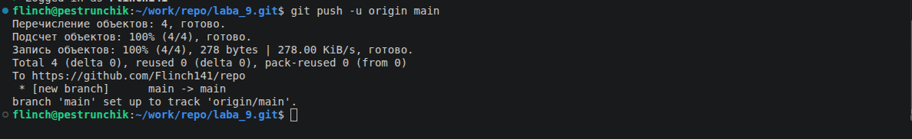
## 3 История коммитов
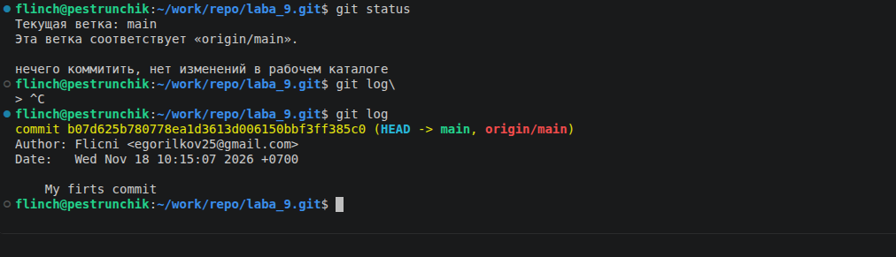
## 4 Добавили в репозиторий файл с сортировкой
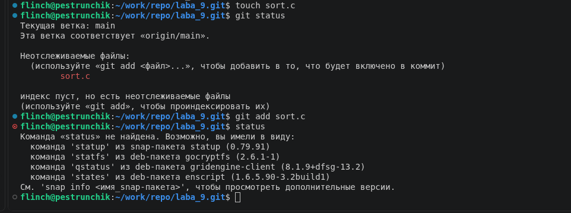
## 5 Проверка статуса после добавления файла
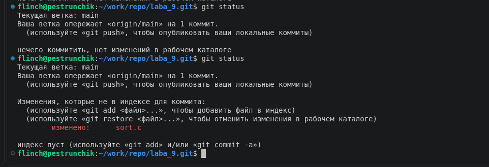
## 6 Скриншот с кодом из файла сортировки
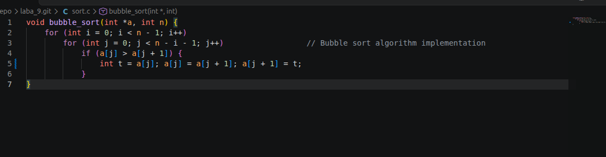
## 7 Добвили файл сортировки индекс
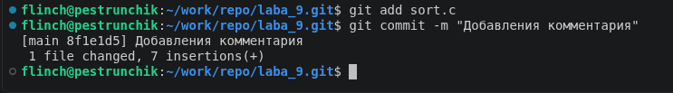
## 8 Сомтрим историю после добавления файла сориторвки в индекс
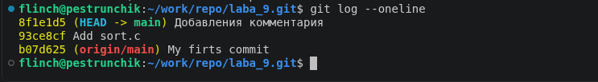
## 9 Добавили второй комментарий, закомитили но повторно не добваили файл в индекс поэтому закомичен только первый комментарий
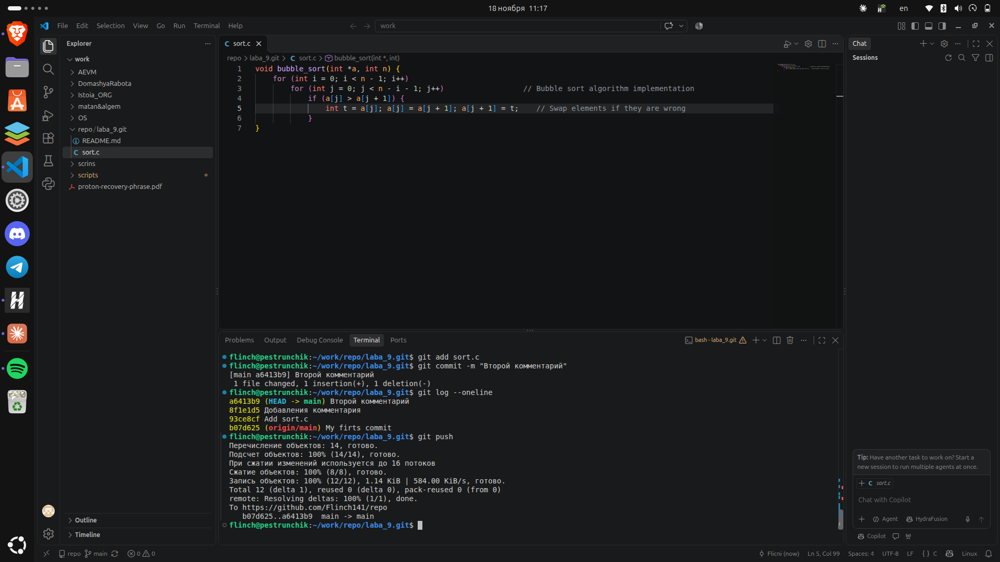
## 10 Создали ветку mybranch
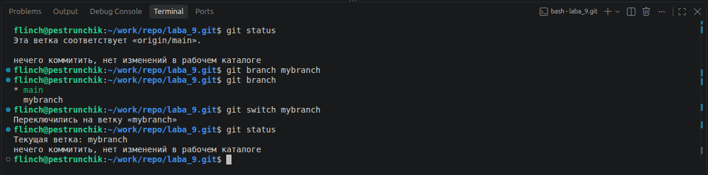
## 11 Перешли на ветку mybranch создали там file1
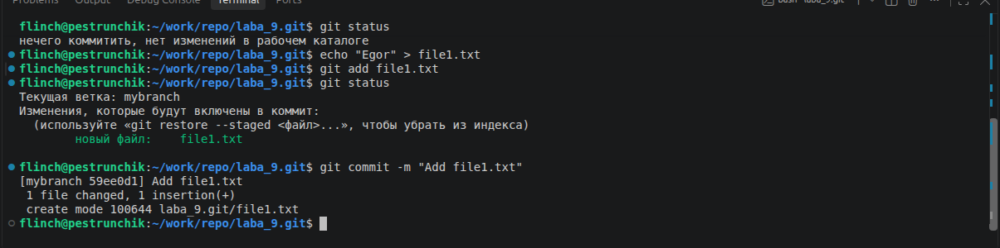
## 12 Сделали коммит на ветке mybranch
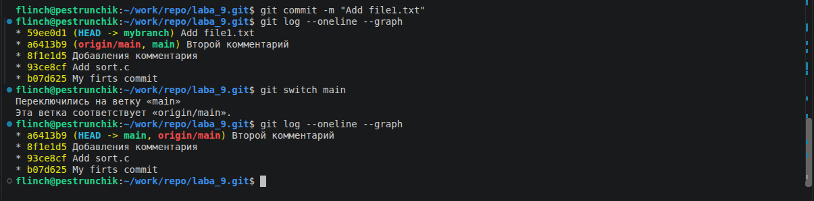
## 13 Перешли обратно в main добавили file2 и сделали коммит
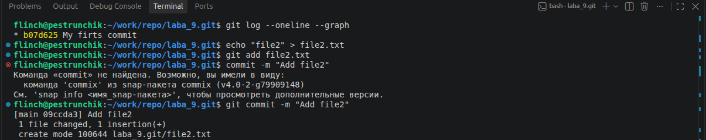
## 14 Пропажа файла file2
## Мы переходим на ветку mybranch и file2 пропадает так как он существует в другой ветке
## 15 Смотрим различие коммитов в main и в mybranch
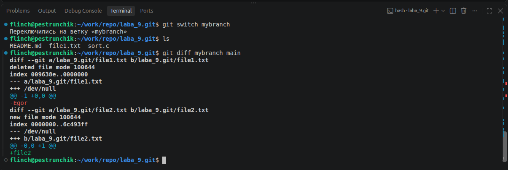
## 16 Добавим этот файл и директорию со скриншотами в индекс
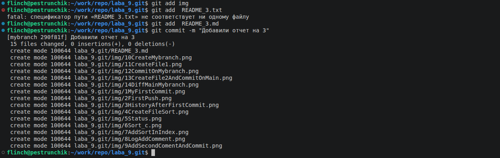
## 17 Пушим на гитхаб

## 18 Проверим гитхаб и убедимся что всё удалось
## Правда теперь придется по новому пушить
